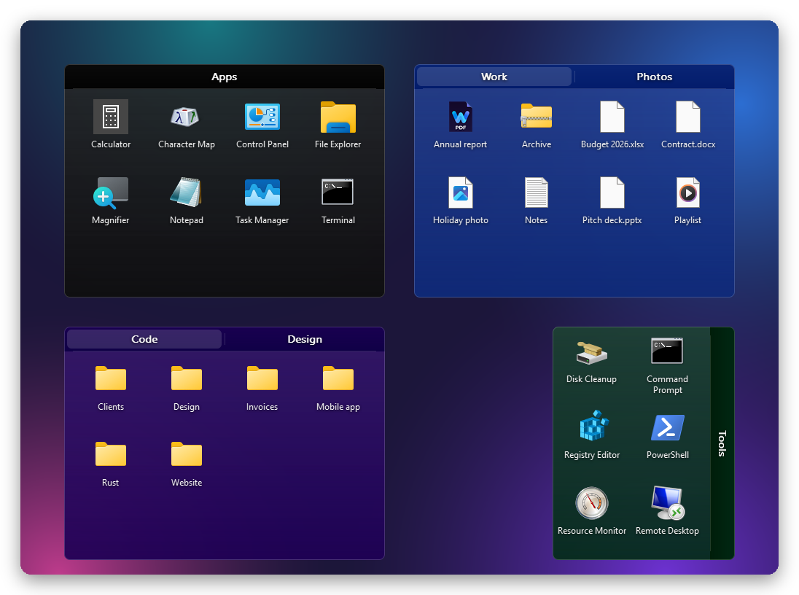
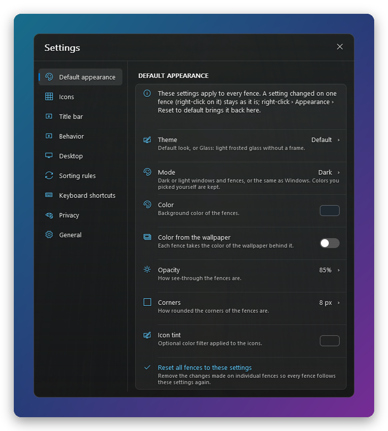

<h1 align="center">Rust Desktop Icons</h1>

<a href="README.md">English</a> · <b>Français</b>

<b>Une alternative gratuite et open source à Fences pour Windows 10 et 11.</b> 
Rangez les icônes de votre bureau dans des zones translucides ou en verre dépoli. Légère, rapide, respectueuse de votre vie privée.

  
  
  
   
  
  
  

<a href="#pourquoi-rust-desktop-icons-">Fonctionnalités</a> · <a href="#installation">Installation</a> · <a href="#prise-en-main">Prise en main</a> · <a href="#questions-fréquentes">FAQ</a>

  <a href="https://github.com/Flybrow/rust-desktop-icons/releases/latest"><b>⬇ Télécharger pour Windows</b></a>

## Pourquoi Rust Desktop Icons ?

<table>
  <tr><td align="center"></td><td align="left"><b>Zones translucides</b></td><td align="left">Derrière toutes les fenêtres, coins jusqu'à 16 px</td></tr>
  <tr><td align="center"></td><td align="left"><b>Thème Glass</b></td><td align="left">Fond d'écran flouté, noms toujours lisibles</td></tr>
  <tr><td align="center"></td><td align="left"><b>Sombre, clair ou automatique</b></td><td align="left">Ou tout simplement comme Windows</td></tr>
  <tr><td align="center"></td><td align="left"><b>À votre goût</b></td><td align="left">Couleurs, tailles, espacement, par zone ou pour toutes</td></tr>
  <tr><td align="center"></td><td align="left"><b>Vues de l'Explorateur</b></td><td align="left">Icônes, liste, détails, mosaïques, contenu</td></tr>
  <tr><td align="center"></td><td align="left"><b>Magnétisme</b></td><td align="left">Repères, espacement égal, rangées d'icônes entières</td></tr>
  <tr><td align="center"></td><td align="left"><b>Repli</b></td><td align="left">Seul le titre reste, la zone s'ouvre au survol</td></tr>
  <tr><td align="center"></td><td align="left"><b>Zones verticales</b></td><td align="left">Titre sur le côté, rangée contre un bord</td></tr>
  <tr><td align="center"></td><td align="left"><b>Onglets et portails</b></td><td align="left">Plusieurs onglets, n'importe quel dossier, ouvert sur place</td></tr>
  <tr><td align="center"></td><td align="left"><b>Groupes et bureaux virtuels</b></td><td align="left">Se déplacent ensemble, s'affichent où vous voulez</td></tr>
  <tr><td align="center"></td><td align="left"><b>Règles de tri</b></td><td align="left">Nouveaux fichiers rangés par type, nom ou âge</td></tr>
  <tr><td align="center"></td><td align="left"><b>Glisser-déposer</b></td><td align="left">Vers, depuis et entre les zones</td></tr>
  <tr><td align="center"></td><td align="left"><b>Aperçu et recherche</b></td><td align="left"><b>Ctrl+Alt+Espace</b>, puis tapez pour trouver</td></tr>
  <tr><td align="center"></td><td align="left"><b>Filtre à la frappe</b></td><td align="left"><b>Ctrl+F</b> ne garde que les icônes qui correspondent</td></tr>
  <tr><td align="center"></td><td align="left"><b>Masquage rapide</b></td><td align="left">Double-clic sur le bureau pour tout masquer</td></tr>
  <tr><td align="center"></td><td align="left"><b>Mode confidentialité</b></td><td align="left">Noms et icônes masqués pendant un partage d'écran</td></tr>
  <tr><td align="center"></td><td align="left"><b>Icônes système</b></td><td align="left">Corbeille, Ce PC et d'autres</td></tr>
  <tr><td align="center"></td><td align="left"><b>Garder les fichiers sur le bureau</b></td><td align="left">Les fichiers restent en place, seules leurs icônes sont masquées</td></tr>
  <tr><td align="center"></td><td align="left"><b>Annuler</b></td><td align="left"><b>Ctrl+Z</b> sur les 20 dernières actions</td></tr>
  <tr><td align="center"></td><td align="left"><b>Changements d'écran</b></td><td align="left">Chaque configuration d'écrans garde sa disposition</td></tr>
  <tr><td align="center"></td><td align="left"><b>Export / import</b></td><td align="left">Toute votre configuration dans un fichier</td></tr>
  <tr><td align="center"></td><td align="left"><b>25 langues</b></td><td align="left">Langue détectée depuis Windows</td></tr>
  <tr><td align="center"></td><td align="left"><b>Mises à jour</b></td><td align="left">En un clic, vérifiées par SHA-256</td></tr>
  <tr><td align="center"></td><td align="left"><b>Privé et léger</b></td><td align="left">Pas de compte, de télémétrie ni de droits administrateur</td></tr>
</table>

## Installation

1. Téléchargez `rust-desktop-icons-x.y.z-x64.msi` depuis la [dernière version](https://github.com/Flybrow/rust-desktop-icons/releases/latest).
2. Lancez-le, sans droits administrateur. L'application démarre aussitôt et ajoute une icône près de l'horloge.

> L'installateur n'est pas encore signé : SmartScreen peut afficher un avertissement, cliquez sur **Informations complémentaires → Exécuter quand même**.

## Prise en main

<table>
  <tr><td align="center"></td><td align="left"><b>Créer une zone</b></td><td align="left">Clic droit sur le bureau → <b>Créer une fenêtre RDI</b>, ou icône de la barre des tâches → <b>Nouvelle zone</b></td></tr>
  <tr><td align="center"></td><td align="left"><b>La remplir</b></td><td align="left">Glissez-y des icônes depuis le bureau, le menu Démarrer ou l'Explorateur</td></tr>
  <tr><td align="center"></td><td align="left"><b>Changer son apparence</b></td><td align="left">Clic droit dessus → <b>Apparence</b> ; pour toutes les zones : icône de la barre des tâches → <b>Paramètres</b></td></tr>
  <tr><td align="center"></td><td align="left"><b>La replier</b></td><td align="left">Double-clic sur sa barre de titre</td></tr>
  <tr><td align="center"></td><td align="left"><b>Tout retrouver</b></td><td align="left"><b>Ctrl+Alt+Espace</b>, puis tapez</td></tr>
</table>

Tout le reste est dans le [guide d'utilisation](docs/guide.md) (en anglais).

## Questions fréquentes

**Où vont mes fichiers ?** Les fichiers du bureau déposés dans une zone sont déplacés dans `%LOCALAPPDATA%\RustDesktopIcons\fences`,
jamais supprimés ; le reste devient un raccourci. Vous les préférez dans votre dossier Bureau ? Activez **Paramètres → Garder les fichiers sur le Bureau**.

**Que se passe-t-il si je désinstalle ?** Tous les fichiers de vos zones reviennent sur le bureau.

**Et ma vie privée ?** Pas de compte, pas de télémétrie, pas de publicité. La seule connexion est la recherche de mises à jour
sur GitHub ; elles sont téléchargées en HTTPS depuis ce dépôt uniquement et vérifiées par leur SHA-256 avant l'installation.

**Est-ce que ça ralentit mon PC ?** Non : Rust et Win32 natifs, sans navigateur intégré ni runtime ; l'application ne fait rien tant que vous ne l'utilisez pas.

## Langues

English, 中文, हिन्दी, Español, Français, العربية, বাংলা, Português, Русский, اردو, Bahasa Indonesia, Deutsch, 日本語,
Kiswahili, मराठी, తెలుగు, Türkçe, தமிழ், Tiếng Việt, 한국어, Italiano, ไทย, Polski, Українська, فارسی.
Corrections bienvenues dans [`src/i18n/table.rs`](src/i18n/table.rs).

## Contribuer

Bugs et idées sont les bienvenus dans les [Issues](https://github.com/Flybrow/rust-desktop-icons/issues). Pour compiler
l'application ou proposer une pull request, voir [CONTRIBUTING.md](CONTRIBUTING.md) (en anglais).

## Licence

[MIT](LICENSE). Créé par vincentxjoubert-lang (aujourd'hui FromHumanToHorse), maintenu par [Flybrow](https://github.com/Flybrow).
Sans lien avec Stardock ; « Fences » est une marque de son propriétaire.
