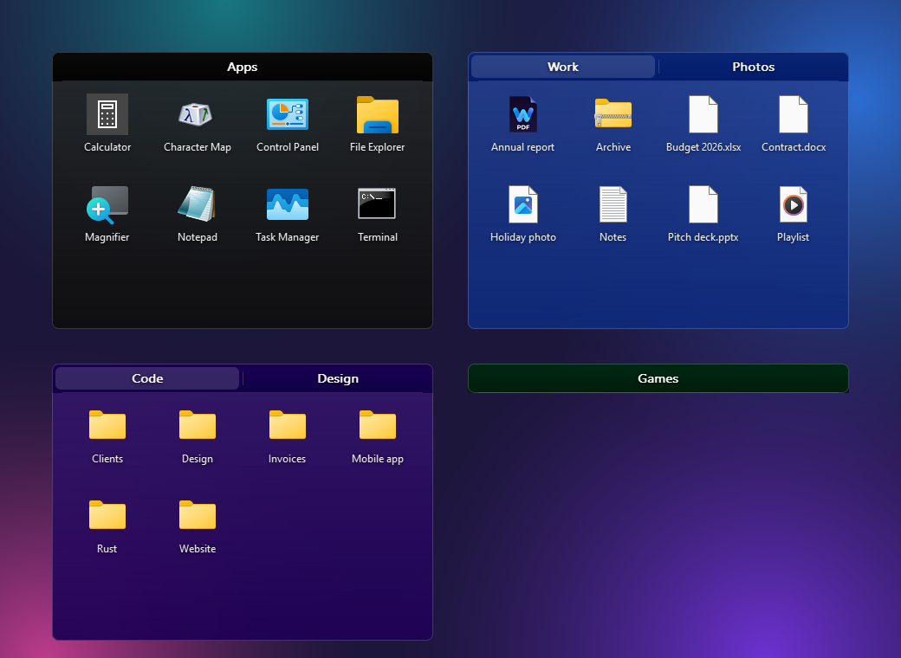
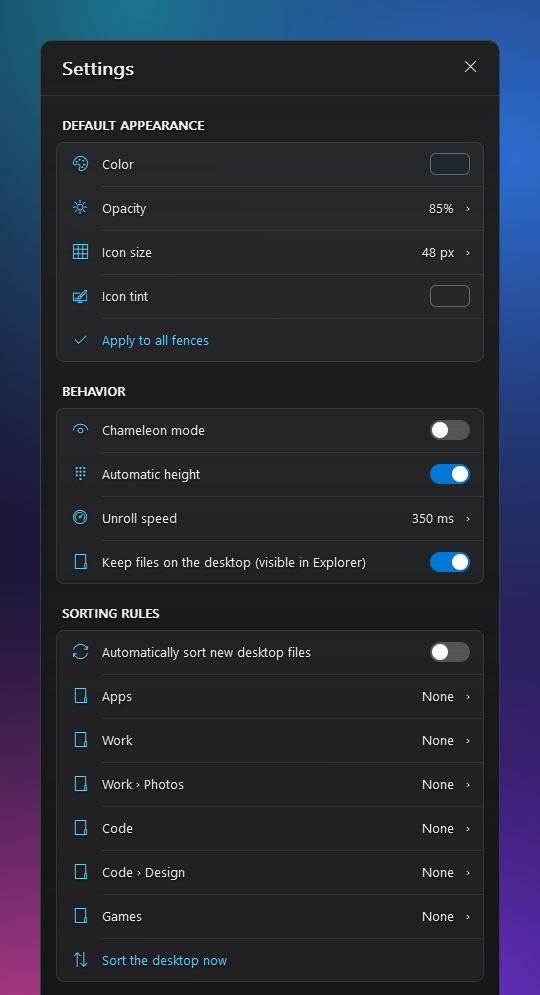

<p align="center"></p>

<h1 align="center">Rust Desktop Icons</h1>

<p align="center"><b>A free, open-source alternative to Fences 6, written entirely in Rust.</b><br>
Organize your Windows desktop into beautiful, translucent groups of icons. Tiny, fast, private.</p>

<p align="center">
  <a href="https://github.com/Flybrow/rust-desktop-icons/releases/latest"></a>
  <a href="https://github.com/Flybrow/rust-desktop-icons/releases"></a>
  <a href="https://github.com/Flybrow/rust-desktop-icons/stargazers"></a>
  <br>
  <a href="https://github.com/Flybrow/rust-desktop-icons/actions/workflows/ci.yml"></a>
  
  
  <a href="LICENSE"></a>
</p>

<p align="center">
  <a href="https://github.com/Flybrow/rust-desktop-icons/releases/latest"><b>⬇ Download for Windows</b></a>
</p>

<p align="center"></p>

## Why Rust Desktop Icons?

|  |  |
| --- | --- |
| 🪟 **Translucent fences** | Rounded, semi-transparent groups that sit on your desktop, behind every window |
| 🎨 **Make it yours** | Any color, opacity, icon size and tint, chameleon mode, rename, resize, lock |
| 📜 **Roll up** | A rolled fence shows only its title and unrolls on hover, away from the screen edge (upward near the bottom) |
| ↔️ **Vertical fences** | Put the title on the side and park the fence on a screen edge: it unrolls toward the middle |
| 🗂️ **Tabs and portals** | Several tabs per fence; a portal tab shows any folder of your PC |
| 🧹 **Sorting rules** | New desktop files go to the right fence automatically (apps, games, images, documents…) |
| 🖥️ **Keep files on the desktop** | Optional: fenced files stay in your Desktop folder (visible in Explorer), only their icons are hidden |
| 🗑️ **Recycle Bin** | Put the Recycle Bin in a fence instead of the desktop |
| 🖱️ **Drag & drop anything** | In, out and between fences; apps from the Start menu or anywhere else become shortcuts |
| ⚡ **Smooth and light** | Native Win32 + Rust, no runtime, no web view |
| 🌍 **25 languages** | Auto-detected from Windows, switchable from the tray menu |
| 🔄 **Silent updates** | Checks GitHub Releases, verifies SHA-256, installs in the background |
| 🔒 **Private** | No account, no telemetry, no ads; the only network call is the update check |
| 👤 **No admin needed** | Per-user installer, optional start with Windows |

<p align="center"></p>

## Install

1. Download `rust-desktop-icons-x.y.z-x64.msi` from the [latest release](https://github.com/Flybrow/rust-desktop-icons/releases/latest).
2. Run it. The app starts right away and adds an icon next to the clock. Installing a newer MSI upgrades the
   installed version in place and keeps your fences.

> The installer is not code-signed yet, so SmartScreen may warn you: click **More info → Run anyway**.
> Each release ships a `.sha256` file: compare it with `Get-FileHash .\rust-desktop-icons-*.msi`.

**Coming from 0.7.x?** Older versions look for updates in the previous project home, so install 0.8.0 once by hand;
updates are automatic again afterwards.

## Usage

| Action | How |
| --- | --- |
| Create a fence | Tray icon → **New fence**, right-click the desktop → **Create an RDI fence**, or right-click a fence |
| Add icons | Drag them onto a fence (from the desktop, Start menu, Explorer…) |
| Open an item | Double-click it |
| Take an item out | Drag it out of the fence, or select it and press **Delete** to send it to the Recycle Bin |
| Rename a fence | Right-click its title |
| Move / resize | Drag the title bar / drag an edge |
| Roll up / down | Double-click the title bar |
| Icon size | **Ctrl + mouse wheel** over a fence |
| Color, tabs, rules, delete | Right-click inside the fence |
| Global options | Tray icon → **Settings** |

By default, files from your own desktop are **moved** into `%LOCALAPPDATA%\RustDesktopIcons\fences\<id>` (never deleted);
anything else gets a **shortcut**, so the original stays where it is. Deleting a fence moves its items back to the desktop.

With **Settings → Keep files on the desktop**, fenced files stay in your Desktop folder instead: Explorer → Desktop
lists them, and only their desktop icons are hidden (placed off-screen; desktop auto-arrange is turned off while the
option is on). Turning it on moves existing fence contents to the desktop; turning it off moves them back.

## Languages

English, 中文, हिन्दी, Español, Français, العربية, বাংলা, Português, Русский, اردو, Bahasa Indonesia, Deutsch, 日本語,
Kiswahili, मराठी, తెలుగు, Türkçe, தமிழ், Tiếng Việt, 한국어, Italiano, ไทย, Polski, Українська, فارسی.

Native speakers: corrections are welcome in [`src/i18n/table.rs`](src/i18n/table.rs).

## Updates and security

- Every 6 hours (first check 30 s after start) the app asks the GitHub API for the latest release.
- A newer `.msi` and its `.sha256` are downloaded **only** from this repository's release URLs over HTTPS; the hash
  must match before `msiexec /qn` runs. The installer then restarts the app.
- Disable it from the tray menu (**Automatic updates**).
- Only documented Windows APIs are used. Dependencies are scanned with `cargo audit` before each release.

## Build from source

```powershell
cargo test
cargo build --release
dotnet tool install --global wix --version 5.0.2
wix extension add -g WixToolset.UI.wixext/5.0.2 WixToolset.Util.wixext/5.0.2
wix build installer/main.wxs -d Version=0.8.0 -arch x64 -ext WixToolset.UI.wixext -ext WixToolset.Util.wixext -o rust-desktop-icons.msi
```

End-to-end checks on a real desktop (isolated data, test files only): `cargo build` then
`cargo run --example keep_e2e` and `cargo run --example unroll_e2e` (moves the mouse for a few seconds).

Pushing a `vX.Y.Z` tag builds and publishes the MSI with [GitHub Actions](.github/workflows/release.yml).

## Architecture

| Module | Role |
| --- | --- |
| `domain/` | Pure, unit-tested logic: model, config, layout grid, sorting, rules, animation, pins |
| `render/`, `layered/` | Pixel compositing (alpha, rounded rectangles, blur) and layered-window painting |
| `fence/` | Fence window: layout, painting, tabs, drag & drop, selection, menus, roll animation |
| `keep/` | "Keep files on the desktop" mode: migration, placement, hiding desktop icons |
| `shell/` | Windows Shell wrappers: icons, shortcuts, folder watch, drag & drop, Recycle Bin, desktop view |
| `app/`, `tray/`, `settings/` | Global state, tray icon and update scheduling, settings window |
| `store.rs`, `rules.rs`, `update.rs` | Persistence and safe moves, desktop auto-sort, release check and silent install |

## Known limitations

- No background blur: Windows only offers it for active windows, and fences are never active.
- Uninstalling moves the items of your fences back to the desktop; files are never deleted.

## Credits

Created by vincentxjoubert-lang (now FromHumanToHorse), maintained by [Flybrow](https://github.com/Flybrow).

## License

[MIT](LICENSE). Not affiliated with Stardock; "Fences" is a trademark of its respective owner.
