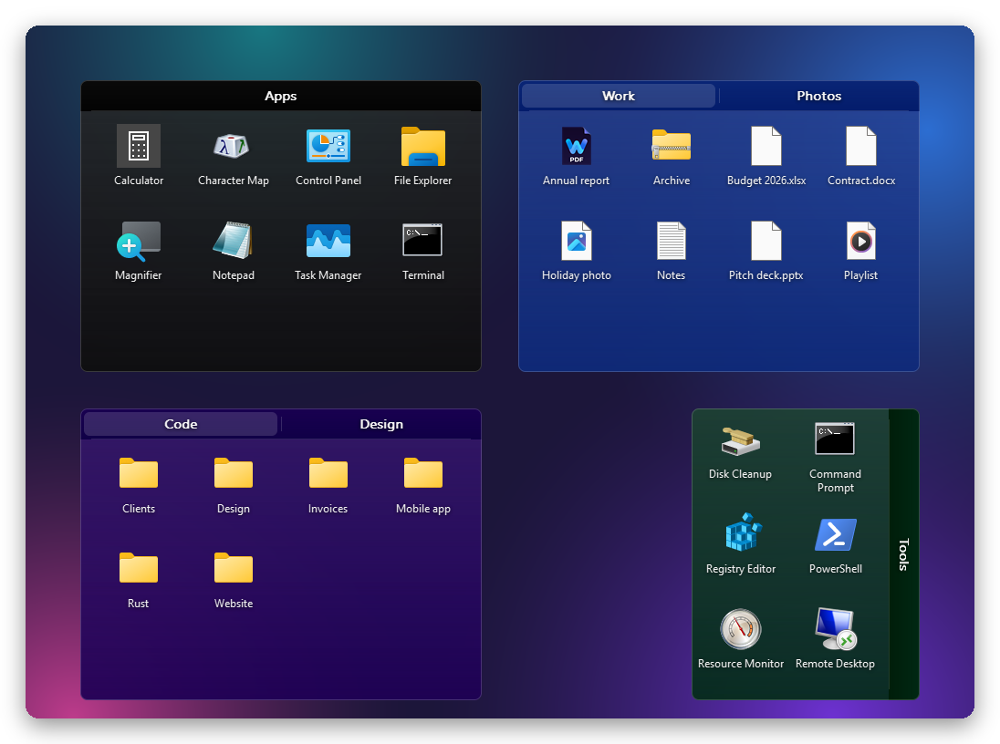
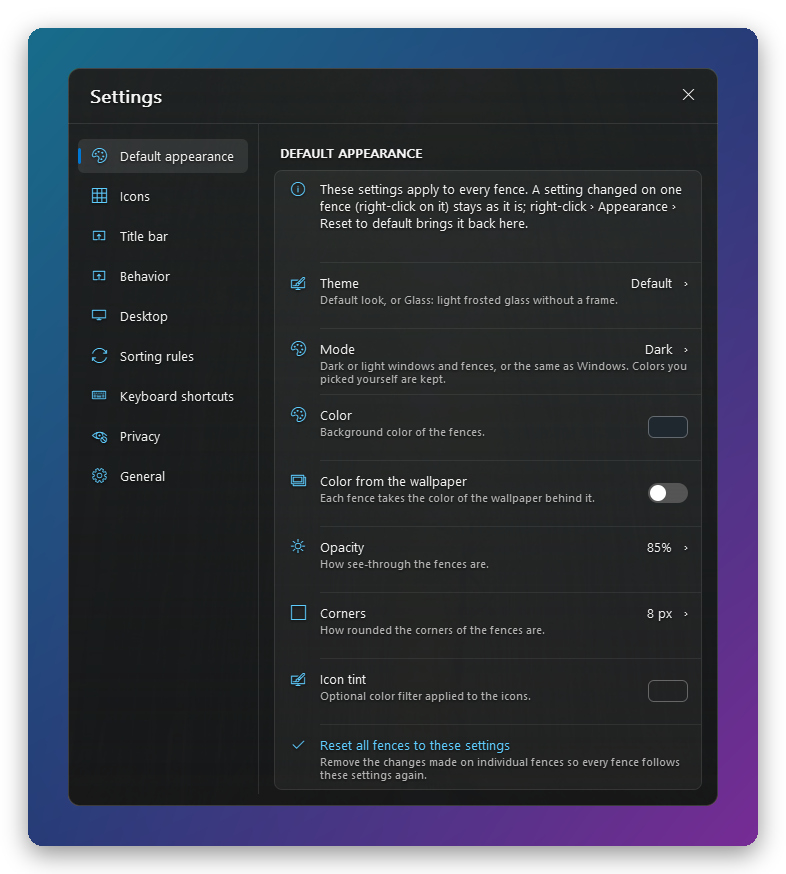

<h1 align="center">Rust Desktop Icons</h1>

<b>English</b> · <a href="README.fr.md">Français</a>

<b>A free, open-source alternative to Fences for Windows 10 and 11.</b> 
Group your desktop icons into translucent or frosted-glass fences. Tiny, fast, private.

  
  
  
   
  
  
  

<a href="#why-rust-desktop-icons">Features</a> · <a href="#install">Install</a> · <a href="#getting-started">Getting started</a> · <a href="#faq">FAQ</a>

  <a href="https://github.com/Flybrow/rust-desktop-icons/releases/latest"><b>⬇ Download for Windows</b></a>

## Why Rust Desktop Icons?

<table>
  <tr><td align="center"></td><td align="left"><b>Translucent fences</b></td><td align="left">Behind every window, corners up to 16 px</td></tr>
  <tr><td align="center"></td><td align="left"><b>Glass theme</b></td><td align="left">Blurred wallpaper, names always readable</td></tr>
  <tr><td align="center"></td><td align="left"><b>Dark, light or automatic</b></td><td align="left">Or simply follow Windows</td></tr>
  <tr><td align="center"></td><td align="left"><b>Make it yours</b></td><td align="left">Colors, sizes, spacing, per fence or all</td></tr>
  <tr><td align="center"></td><td align="left"><b>File Explorer views</b></td><td align="left">Icons, list, details, tiles, content</td></tr>
  <tr><td align="center"></td><td align="left"><b>Snapping</b></td><td align="left">Guide lines, equal spacing, whole icon rows</td></tr>
  <tr><td align="center"></td><td align="left"><b>Roll up</b></td><td align="left">Only the title shows, opens on hover</td></tr>
  <tr><td align="center"></td><td align="left"><b>Vertical fences</b></td><td align="left">Title on the side, parked on an edge</td></tr>
  <tr><td align="center"></td><td align="left"><b>Tabs and portals</b></td><td align="left">Many tabs, any folder, opened inside</td></tr>
  <tr><td align="center"></td><td align="left"><b>Groups and virtual desktops</b></td><td align="left">Move together, show up where you want</td></tr>
  <tr><td align="center"></td><td align="left"><b>Sorting rules</b></td><td align="left">New files sorted by kind, name or age</td></tr>
  <tr><td align="center"></td><td align="left"><b>Drag &amp; drop anything</b></td><td align="left">In, out and between fences</td></tr>
  <tr><td align="center"></td><td align="left"><b>Peek and search</b></td><td align="left"><b>Ctrl+Alt+Space</b>, then type to find</td></tr>
  <tr><td align="center"></td><td align="left"><b>Filter as you type</b></td><td align="left"><b>Ctrl+F</b> keeps only matching icons</td></tr>
  <tr><td align="center"></td><td align="left"><b>Quick hide</b></td><td align="left">Double-click the desktop to hide all</td></tr>
  <tr><td align="center"></td><td align="left"><b>Privacy mode</b></td><td align="left">Names and icons masked while sharing</td></tr>
  <tr><td align="center"></td><td align="left"><b>System icons</b></td><td align="left">Recycle Bin, This PC and more</td></tr>
  <tr><td align="center"></td><td align="left"><b>Keep files on the desktop</b></td><td align="left">Files stay put, only icons hide</td></tr>
  <tr><td align="center"></td><td align="left"><b>Undo</b></td><td align="left"><b>Ctrl+Z</b> on the last 20 actions</td></tr>
  <tr><td align="center"></td><td align="left"><b>Screen changes</b></td><td align="left">Each monitor setup keeps its layout</td></tr>
  <tr><td align="center"></td><td align="left"><b>Export / import</b></td><td align="left">Your whole setup in one file</td></tr>
  <tr><td align="center"></td><td align="left"><b>25 languages</b></td><td align="left">Detected from Windows</td></tr>
  <tr><td align="center"></td><td align="left"><b>Updates</b></td><td align="left">One click, SHA-256 verified</td></tr>
  <tr><td align="center"></td><td align="left"><b>Private and light</b></td><td align="left">No account, telemetry or admin rights</td></tr>
</table>

## Install

1. Download `rust-desktop-icons-x.y.z-x64.msi` from the [latest release](https://github.com/Flybrow/rust-desktop-icons/releases/latest).
2. Run it: no admin rights needed. The app starts at once and adds an icon next to the clock.

> The installer is not code-signed yet, so SmartScreen may warn you: click **More info → Run anyway**.

## Getting started

<table>
  <tr><td align="center"></td><td align="left"><b>Create a fence</b></td><td align="left">Right-click the desktop → <b>Create an RDI fence</b>, or tray icon → <b>New fence</b></td></tr>
  <tr><td align="center"></td><td align="left"><b>Fill it</b></td><td align="left">Drag icons onto it from the desktop, the Start menu or File Explorer</td></tr>
  <tr><td align="center"></td><td align="left"><b>Change its look</b></td><td align="left">Right-click it → <b>Appearance</b>; for every fence: tray icon → <b>Settings</b></td></tr>
  <tr><td align="center"></td><td align="left"><b>Roll it up</b></td><td align="left">Double-click its title bar</td></tr>
  <tr><td align="center"></td><td align="left"><b>Find anything</b></td><td align="left"><b>Ctrl+Alt+Space</b>, then type</td></tr>
</table>

Everything else is in the [user guide](docs/guide.md).

## FAQ

**Where do my files go?** Desktop files you drop on a fence are moved to `%LOCALAPPDATA%\RustDesktopIcons\fences`, never
deleted; anything else gets a shortcut. Prefer them in your Desktop folder? Turn on **Settings → Keep files on the desktop**.

**What happens if I uninstall?** Every file in your fences goes back to the desktop.

**Is it private?** No account, no telemetry, no ads. The only network call is the update check on GitHub; updates are
downloaded over HTTPS from this repository only and checked against their SHA-256 before installing.

**Does it slow down my PC?** No: native Rust and Win32, no web view, no runtime; it stays idle until you use it.

## Languages

English, 中文, हिन्दी, Español, Français, العربية, বাংলা, Português, Русский, اردو, Bahasa Indonesia, Deutsch, 日本語,
Kiswahili, मराठी, తెలుగు, Türkçe, தமிழ், Tiếng Việt, 한국어, Italiano, ไทย, Polski, Українська, فارسی.
Native speakers: corrections are welcome in [`src/i18n/table.rs`](src/i18n/table.rs).

## Contributing

Bug reports and ideas are welcome in [Issues](https://github.com/Flybrow/rust-desktop-icons/issues). To build the app
or send a pull request, see [CONTRIBUTING.md](CONTRIBUTING.md).

## License

[MIT](LICENSE). Created by vincentxjoubert-lang (now FromHumanToHorse), maintained by [Flybrow](https://github.com/Flybrow).
Not affiliated with Stardock; "Fences" is a trademark of its respective owner.
